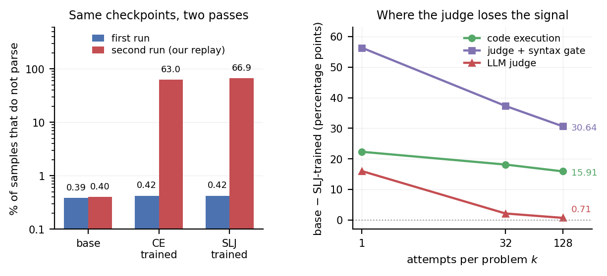

<h1 align="center">Impossible Code,<br>Barely Changed Score</h1>

<p align="center"><em>A Replay Study of Judge-Based Evaluation</em></p>
<p align="center"><sub>Masoud Fetanat &nbsp;&middot;&nbsp; UNSW Sydney</sub></p>

<p align="center">
  <a href="https://arxiv.org/pdf/2611.01572"></a>
  &nbsp;
  <a href="https://curiousorbitnotes.github.io/evorobust-replay-study/"></a>
  &nbsp;
  <a href="#citation"></a>
</p>

> **Most later answers were no longer valid Python. The judge-based score barely changed.**

We repeated an earlier coding evaluation on **421 HumanEval and MBPP problems**. Two GRPO-trained checkpoints produced invalid Python on **63%-67%** of their later answers, while their judge-based Pass@32 scores fell by only about **3 percentage points**.

Our recommendation is simple: **report the syntax-pass rate alongside judge-based scores.** A syntax check is cheap and can expose failures hidden by a high score. Passing it does not prove that the program is correct.

For setup, data requirements and caveats, see the [reproducibility guide](docs/REPRODUCIBILITY.md).

<p align="center">
  
</p>

## What changed?

For the checkpoint trained with the strong language-model judge (SLJ-trained):

| Measurement | Original run | Later run |
|---|---:|---:|
| Answers that fail the syntax check | 0.42% | **66.90%** |
| Judge-based Pass@32 | 96.67% | **93.95%** |

The syntax rate counts individual answers. Pass@32 is a per-problem score based on multiple attempts, so these are different measurements. With 128 attempts on the later outputs, the same checkpoint scores **96.44% under the judge** and **28.27% under hardened execution tests**.

## Recreate the figure

Use Python 3.10. This reads the included summaries and makes no model calls.

```bash
git clone https://github.com/curiousorbitnotes/evorobust-replay-study.git
cd evorobust-replay-study
pip install -r requirements.txt
python scripts/evorobust_figure.py
```

The command writes Figure 1 as PDF and PNG and refreshes the website image. See the [reproducibility guide](docs/REPRODUCIBILITY.md) for inputs, units, scorer differences and full analysis instructions.

## Explore the release

| Resource | What you will find |
|---|---|
| [Analysis scripts](scripts/) | Syntax checks, scorer comparisons, bootstrap intervals and controls |
| [Scorers](rewards/) | Code extraction, the original execution reward and the exact judge prompt |
| [Summary results](tables/) | Machine-readable results and documented published snapshots |
| [Benchmark questions](data/code/eval.json) | 164 HumanEval and 257 sanitized MBPP test questions |
| [Reproducibility and limitations](docs/REPRODUCIBILITY.md) | Setup, provenance, data requirements and caveats |

**Scope and availability.** The cause of the replay difference remains unresolved. For the trained runs, the cached judge verdicts are assumed to match their answers. This release does not include checkpoints, generated answers, judge verdicts or per-sample scores, so full analysis reruns require those retained inputs. The paper's execution results use the hardened harness. The original execution reward is preserved separately and has documented limitations.

## License

Code is [MIT licensed](LICENSE). Benchmark questions retain their [original licenses](THIRD_PARTY_NOTICES.md).

## Citation

<details>
<summary>Show BibTeX</summary>

```bibtex
@misc{fetanat2026impossible,
  title         = {Impossible Code, Barely Changed Score: A Replay Study of Judge-Based Evaluation},
  author        = {Fetanat, Masoud},
  year          = {2026},
  eprint        = {2611.01572},
  archivePrefix = {arXiv},
  primaryClass  = {cs.SE},
  note          = {Accepted at the NeurIPS 2026 EvoRobust Workshop},
  url           = {https://arxiv.org/abs/2611.01572}
}
```

</details>
